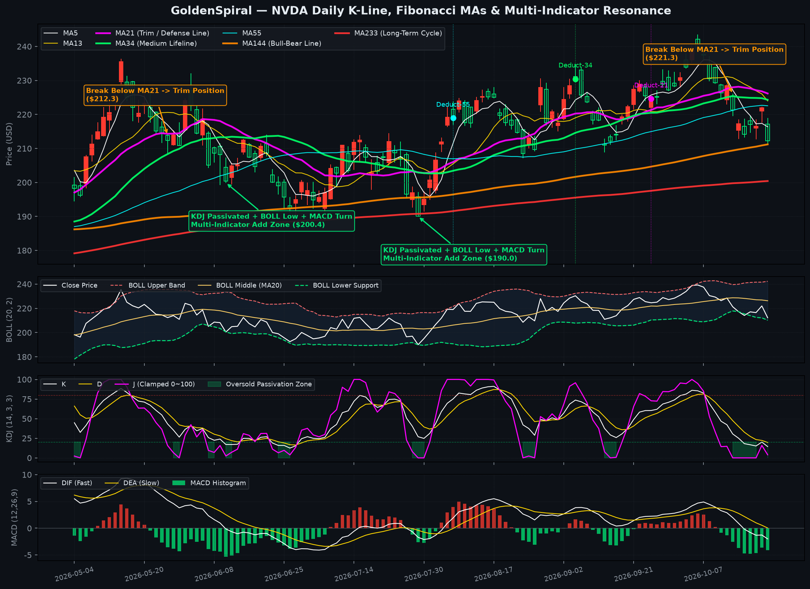
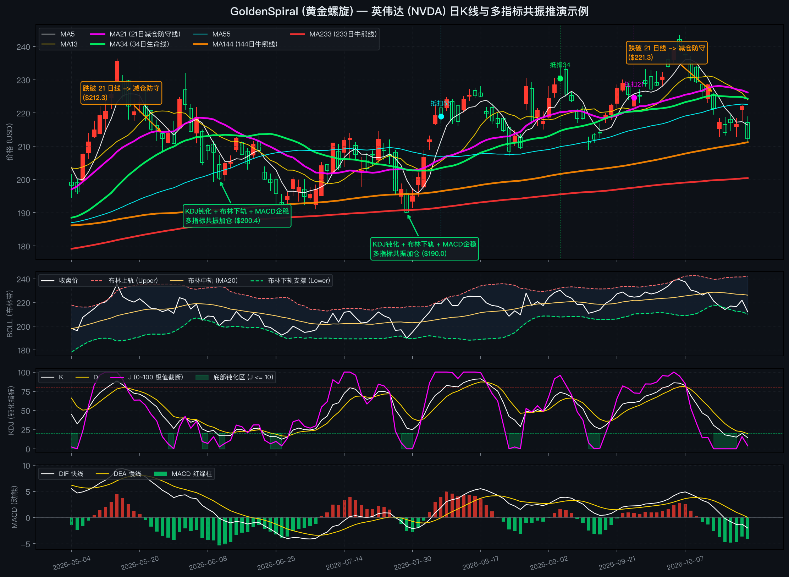

<div align="center">

**Language**: [English](#goldenspiral--fibonacci-ma--multi-indicator-resonance-demo) | [简体中文](#goldenspiral-黄金螺旋--斐波那契均线簇与多指标共振公开演示版) | [Standalone Chinese Doc (README_ZH.md)](README_ZH.md)

</div>

---

# GoldenSpiral — Fibonacci MA & Multi-Indicator Resonance Demo

> **Public Showcase Edition**  
> This repository is a lightweight public showcase of the **GoldenSpiral AI Agent Skill**. It demonstrates the core **Fibonacci Moving Average Matrix**, **Lookahead Differential Deduction**, and **Multi-Indicator Resonance (`BOLL` + `KDJ` + `MACD`)** using **NVIDIA (`NVDA`)** Daily K-lines as a case study. Proprietary intraday order-book rules and full course materials are maintained in a separate private repository.

---

## 📊 Visual Case Study: NVIDIA (`NVDA`) Daily K-Line



### How to Read This Example

1. **🟠 When to Trim Position (`Break Below MA21 -> Trim Position`)**
   - During an uptrend, **`MA21` (bold magenta)** serves as the short-to-medium wave defense line.
   - When `NVDA` closes decisively below `MA21` (for example, at **`\$212.3`** in late May or **`\$221.3`** in mid-October) and short-term moving averages turn downward under high deduction-price pressure, **trim or reduce positions** to lock in gains and guard against deeper pullbacks.

2. **🟢 When to Add Position (`KDJ Passivation + BOLL Lower + MACD Turn`)**
   - Instead of guessing the bottom with a single indicator, wait for **multi-indicator resonance** near major Fibonacci moving averages (`MA144` / `MA233`):
     1. **KDJ Oversold Passivation**: The `J` line flattens near `0` (clamped inside `[0, 100]`) within the green shaded oversold zone (`<= 10`), signaling that short-term selling pressure is exhausted.
     2. **Bollinger Band Support (`BOLL`)**: Price touches or briefly pierces the **BOLL Lower Band** and stabilizes.
     3. **MACD Momentum Recovery**: Bearish green histogram bars stop expanding and start shrinking, or `DIF` turns upward toward `DEA`.
   - As shown on the chart at **`\$200.4`** (early June) and **`\$190.0`** (late July), this triple-indicator alignment right above the rising `MA144/233` bull-bear lines marks a high-probability zone to add positions.

---

## 🧭 Core Framework Explanation

### 1. Fibonacci Moving Average Matrix (`8-MA System`)

Instead of conventional `5 / 10 / 20 / 60` moving averages, GoldenSpiral uses numbers from the **Fibonacci sequence** (`5, 13, 21, 34, 55, 144, 233, 623`) to capture natural market rhythm across three horizons:

| Horizon Group | Periods | Chart Color | Role & Practical Meaning |
| :--- | :--- | :--- | :--- |
| **Short-Term Group** | **`MA5` / `MA13` / `MA21`** | White / Gold / **Magenta** | Tracks short-term momentum and pullback rhythm. **`MA21` is the active wave defense / trim line.** |
| **Medium-Term Group** | **`MA34` (Bold) / `MA55`** | **Green** / Cyan | **`MA34` is the Medium-Term Lifeline** defining bull vs. bear trend structure. |
| **Long-Term Group** | **`MA144` / `MA233` / `MA623`** | **Orange** / **Red** / SlateBlue | **`MA144` & `MA233` are Bull-Bear Boundaries** acting as long-term institutional cost bases and major pullback floors. |

---

### 2. "Lookahead" Differential Deduction

Conventional moving average analysis looks backward at lagging crossovers. A Simple Moving Average (SMA) of period $N$ changes from yesterday to today according to the exact first-order difference identity:

$$\Delta \text{MA}(N) = \text{MA}_t(N) - \text{MA}_{t-1}(N) = \frac{C_t - C_{t-N}}{N}$$

- **$C_t$ (`Current Close`)**: Today's closing price.
- **$C_{t-N}$ (`Deduction Price`)**: The closing price $N$ bars ago (marked as `Deduct-21`, `Deduct-34`, `Deduct-55` on the chart).
- **Practical Implication**:
  - If **$C_t > C_{t-N}$**, the moving average **must slope upward**, providing dynamic support.
  - If **$C_t < C_{t-N}$**, the moving average **must slope downward**, creating overhead resistance.
  - By inspecting the historical prices around $t - N$, you can anticipate when a falling moving average is about to flatten out ("brake") or turn upward before the crossover actually occurs.

---

## 🚀 Quick Start

### 1. Install Dependencies
```bash
pip install -r requirements.txt
```

### 2. Run the Showcase Demo
```bash
# Default: Generate both pure English and pure Chinese charts & reports using the bundled NVDA dataset
python3 demo.py

# Pure English console output & English chart only
python3 demo.py NVDA --lang en

# Pure Chinese console output & Chinese chart only
python3 demo.py NVDA --lang zh

# Optional: Fetch live forward-adjusted data for any US stock or A-share ticker via AKShare
python3 demo.py AAPL --lang en
```

### 3. Sample Console Output (English)
```text
==============================================================================
  GoldenSpiral Public Showcase — NVDA Daily K-Line & Lookahead Deduction
==============================================================================

[+] Latest Market Bar (2026-10-22):
    Close: $212.21 | MA21 (Trim Line): $226.17 | MA34 (Lifeline): $224.30
    BOLL Lower: $210.16 | KDJ (J): 3.9 | MACD Hist: -4.08

[+] Lookahead Differential Deduction Table (ΔMA = (Close - Deduct) / N):
------------------------------------------------------------------------------
    MA(  5) | Deduct Date: 2026-10-16 | Deduct Price: $ 214.13 | Diff:   -1.92 -> Bearish Pressure (Close < Deduct)
    MA( 13) | Deduct Date: 2026-10-06 | Deduct Price: $ 239.24 | Diff:  -27.03 -> Bearish Pressure (Close < Deduct)
    MA( 21) | Deduct Date: 2026-09-24 | Deduct Price: $ 224.58 | Diff:  -12.37 -> Bearish Pressure (Close < Deduct)
    MA( 34) | Deduct Date: 2026-09-04 | Deduct Price: $ 230.36 | Diff:  -18.15 -> Bearish Pressure (Close < Deduct)
    MA( 55) | Deduct Date: 2026-08-06 | Deduct Price: $ 218.99 | Diff:   -6.78 -> Bearish Pressure (Close < Deduct)
    MA(144) | Deduct Date: 2026-03-30 | Deduct Price: $ 164.92 | Diff:  +47.29 -> Bullish Support (Close > Deduct)
    MA(233) | Deduct Date: 2025-11-18 | Deduct Price: $ 181.09 | Diff:  +31.12 -> Bullish Support (Close > Deduct)
    MA(623) | Deduct Date: 2024-04-30 | Deduct Price: $  86.07 | Diff: +126.14 -> Bullish Support (Close > Deduct)
------------------------------------------------------------------------------
```

### ⚠️ Disclaimer
This repository is for educational, quantitative visualization, and AI Agent Skill demonstration purposes only. Nothing herein constitutes financial or investment advice.

---
---

# GoldenSpiral (黄金螺旋) — 斐波那契均线簇与多指标共振公开演示版

> **公开演示版说明**  
> 本仓库是 **GoldenSpiral AI Agent Skill** 的公开概念演示版本。以 **英伟达 (`NVDA`)** 日 K 线为例，展示**斐波那契均线簇**、**“向右看”抵扣价差分推演**以及 **底部多指标共振（`BOLL` + `KDJ` + `MACD`）** 的可视化分析逻辑。完整的盘口微观规则与内部资料保存在私有库中，不对外公开。

---

## 📊 可视化实战示例：英伟达 (`NVDA`) 日 K 线推演



### 极简读图与操作示例

1. **🟠 何时减仓防守（`跌破 21 日线 -> 减仓防守`）**
   - 在上升趋势波段中，**`MA21`（21日均线，紫色加粗）** 是短中线波段的减仓防守线。
   - 当英伟达日 K 线有效跌破 `MA21`（如图中 5 月下旬跌破 **`\$212.3`** 或 10 月中旬跌破 **`\$221.3`**），且短期抵扣价处于历史高位形成压制时，应当**先行减仓防守**，锁定波段利润并规避后续回调。

2. **🟢 何时加仓低吸（`KDJ钝化 + 布林下轨 + MACD企稳 -> 多指标共振加仓`）**
   - 回调过程中不靠主观猜底，而是等待股价回踩大周期牛熊线（`MA144` / `MA233`）附近时出现**三重指标共振**：
     1. **KDJ 底部钝化**：`J` 值打穿极值并在 `0` 附近连续走平钝化（图中绿色阴影区 `J <= 10`），代表短线抛压已极致宣泄；
     2. **布林带下轨支撑（`BOLL`）**：股价触及或瞬间刺穿**布林下轨**后收脚企稳；
     3. **MACD 动能转强**：底部绿柱不再放大并开始缩短（空头动能衰竭）或快慢线拐头收敛。
   - 如图中 6 月上旬 **`\$200.4`** 与 7 月底 **`\$190.0`** 两个位置，均在大均线托底背景下触发三指标共振，构成高胜率的波段加仓区。

---

## 🧭 核心体系概念简述

### 1. 斐波那契八均线系统

本体系采用斐波那契自然数列（`5, 13, 21, 34, 55, 144, 233, 623`）构建**短、中、长三族均线**，替代传统的 `5 / 10 / 20 / 60` 均线：

| 均线分族 | 周期参数 | 图表颜色 | 核心角色与实战意义 |
| :--- | :--- | :--- | :--- |
| **短线族** | **`MA5` / `MA13` / `MA21`** | 白 / 黄 / **紫（加粗）** | 反映短期资金攻击斜率；其中 **`MA21` 为波段减仓防守线**。 |
| **中线族** | **`MA34`（加粗） / `MA55`** | **绿（加粗）** / 青 | **`MA34` 为中线多空生命线**，决定中期波段趋势的强弱分界。 |
| **长线族** | **`MA144` / `MA233` / `MA623`** | **橙（加粗）** / **红（加粗）** / 蓝紫 | **`MA144` 与 `MA233` 为牛熊分界线**，刻画大周期机构成本底座与回调强支撑。 |

---

### 2. “向右看”：间隔线与抵扣价差分推演

常规均线分析习惯等金叉或死叉出现后再行动，属于滞后的“向左看”。周期为 $N$ 的简单移动平均线，其每日斜率变化量 $\Delta \text{MA}(N)$ 由以下一阶差分恒等式严格决定：

$$\Delta \text{MA}(N) = \text{MA}_t(N) - \text{MA}_{t-1}(N) = \frac{C_t - C_{t-N}}{N}$$

- **$C_t$（现价）**：当日最新收盘价。
- **$C_{t-N}$（抵扣价 / 间隔线位置）**：往前数第 $N$ 根 K 线的收盘价（即图上标注的 `抵扣21`、`抵扣34`、`抵扣55`）。
- **实战推演意义**：
  - 当 **`现价 > 抵扣价`** 时，均线必然**向上助涨**，构成动态支撑；
  - 当 **`现价 < 抵扣价`** 时，均线必然**向下压制**，构成上方阻力；
  - 通过观察未来几个交易日即将抵扣的历史高低位区域，即可在今天提前预判均线何时走平“刹车”或拐头向上。

---

## 🚀 快速运行指南

### 1. 安装环境依赖
```bash
pip install -r requirements.txt
```

### 2. 运行演示脚本
```bash
# 默认运行：使用内置英伟达 (NVDA) 日线数据，同时生成纯英文与纯中文两套高清图表
python3 demo.py

# 仅输出纯中文终端报告与纯中文图表
python3 demo.py NVDA --lang zh

# 仅输出纯英文终端报告与纯英文图表
python3 demo.py NVDA --lang en
```

### 3. 终端输出示例（中文）
```text
==========================================================================
  GoldenSpiral (黄金螺旋) 公开演示版 — NVDA 日K线与抵扣价推演
==========================================================================

[+] 最新交易日行情 (2026-10-22):
    收盘价: $212.21 | MA21(减仓线): $226.17 | MA34(生命线): $224.30
    布林下轨: $210.16 | KDJ(J值): 3.9 | MACD柱: -4.08

[+] “向右看”抵扣价差分推演表 (ΔMA = (现价 - 抵扣价) / N):
--------------------------------------------------------------------------
    MA(  5) | 抵扣日期: 2026-10-16 | 抵扣价: $ 214.13 | 差值:   -1.92 -> 向下压制 (现价 < 抵扣价)
    MA( 13) | 抵扣日期: 2026-10-06 | 抵扣价: $ 239.24 | 差值:  -27.03 -> 向下压制 (现价 < 抵扣价)
    MA( 21) | 抵扣日期: 2026-09-24 | 抵扣价: $ 224.58 | 差值:  -12.37 -> 向下压制 (现价 < 抵扣价)
    MA( 34) | 抵扣日期: 2026-09-04 | 抵扣价: $ 230.36 | 差值:  -18.15 -> 向下压制 (现价 < 抵扣价)
    MA( 55) | 抵扣日期: 2026-08-06 | 抵扣价: $ 218.99 | 差值:   -6.78 -> 向下压制 (现价 < 抵扣价)
    MA(144) | 抵扣日期: 2026-03-30 | 抵扣价: $ 164.92 | 差值:  +47.29 -> 向上助涨 (现价 > 抵扣价)
    MA(233) | 抵扣日期: 2025-11-18 | 抵扣价: $ 181.09 | 差值:  +31.12 -> 向上助涨 (现价 > 抵扣价)
    MA(623) | 抵扣日期: 2024-04-30 | 抵扣价: $  86.07 | 差值: +126.14 -> 向上助涨 (现价 > 抵扣价)
--------------------------------------------------------------------------
```

### ⚠️ 免责声明
本仓库仅用于量化可视化与 AI Agent Skill 结构的公开技术演示，不构成任何投资或买卖建议。
