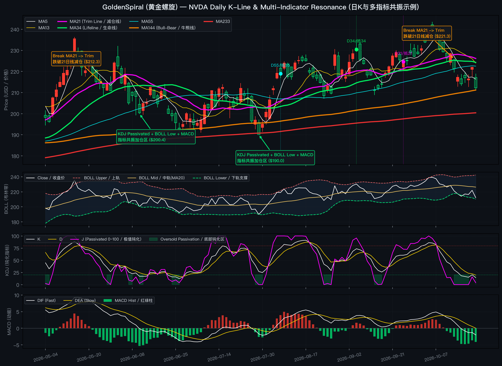

# GoldenSpiral (黄金螺旋) — Fibonacci MA & Multi-Indicator Resonance Demo
# GoldenSpiral (黄金螺旋) — 斐波那契均线簇与多指标共振公开演示版

> **Public Showcase Edition / 公开演示版说明**  
> **[EN]** This repository is a lightweight public showcase of the **GoldenSpiral AI Agent Skill**. It demonstrates the core **Fibonacci Moving Average Matrix**, **Lookahead Differential Deduction**, and **Multi-Indicator Resonance (`BOLL` + `KDJ` + `MACD`)** using **NVIDIA (`NVDA`)** Daily K-lines as a case study. Proprietary intraday order-book rules and full course materials are kept in a separate private repository.  
> **[中文]** 本仓库是 **GoldenSpiral AI Agent Skill** 的公开概念演示版本。以 **英伟达 (`NVDA`)** 日 K 线为例，展示**斐波那契均线簇**、**“向右看”抵扣价差分推演**以及 **底部多指标共振（`KDJ` + `BOLL` + `MACD`）** 的可视化分析逻辑。完整的盘口微观规则与内部资料保存在私有库中，不对外公开。

---

## 📊 Visual Case Study: NVIDIA (`NVDA`) Daily K-Line
## 📊 可视化实战示例：英伟达 (`NVDA`) 日 K 线推演



### How to Read This Example / 极简读图与操作示例

1. **🟠 When to Trim Position (破线减仓 — `Break Below MA21`)**
   - **[EN]** During an uptrend, **`MA21` (bold magenta)** serves as the short-to-medium wave defense line. When `NVDA` closes decisively below `MA21` (e.g., at **`\$212.3`** in late May or **`\$221.3`** in mid-October) and short-term moving averages turn downward, **trim/reduce position** to lock in gains and avoid deeper pullbacks.
   - **[中文]** 在上升波段中，**`21日均线`（紫色加粗）** 是短中线波段的防守减仓线。当英伟达日 K 线有效跌破 `MA21`（如图中 5 月下旬跌破 **`\$212.3`** 或 10 月中旬跌破 **`\$221.3`**），且短期抵扣价处于高位形成压制时，应当**先行减仓防守**，规避后续回调。

2. **🟢 When to Add Position (多指标共振加仓 — `KDJ Passivation + BOLL Lower + MACD`)**
   - **[EN]** Instead of guessing the bottom with a single indicator, wait for **triple resonance** near major Fibonacci moving averages (`MA144` / `MA233`):
     1. **KDJ Oversold Passivation**: `J` line flattens near `0` (clamped inside `[0, 100]`) inside the green shaded oversold zone (`<20`).
     2. **Bollinger Band Support (`BOLL`)**: Price touches or pierces the **BOLL Lower Band (`下轨支撑`)** and stabilizes.
     3. **MACD Momentum Recovery**: Bearish green histogram bars stop expanding and start shrinking (`绿柱缩短 / 动能衰竭`) or form a bullish crossover (`DIF` turns up toward `DEA`).
   - **[中文]** 回调何时加仓？不靠主观猜底，而是等待**底部三指标共振**（如图中 **`\$200.4`** 与 **`\$190.0`** 回踩 `MA144/233` 牛熊线区域）：
     1. **KDJ 底部钝化**：`J` 值打穿极值并在 `0` 附近连续走平钝化（绿色阴影区），代表短线抛压极致宣泄；
     2. **BOLL 布林下轨支撑**：股价触及或瞬间刺穿 **布林带下轨（`BOLL Lower`）** 后收脚企稳；
     3. **MACD 动能转强**：底部绿柱不再放大并开始缩短（背离或即将金叉），结合大均线（`MA144/233`）走平托底，构成高胜率的**波段加仓点**。

---

## 🧭 Core Framework Explanation / 核心体系概念简述

### 1. Fibonacci Moving Average Matrix / 斐波那契均线簇

**[EN]** Instead of arbitrary `5 / 10 / 20 / 60` moving averages, GoldenSpiral uses numbers from the **Fibonacci sequence** (`5, 13, 21, 34, 55, 144, 233, 623`) to capture natural market rhythm across three horizons:  
**[中文]** 本体系采用斐波那契自然数列构建**短、中、长三族均线**，替代传统的 `5/10/20/60` 均线：

| Group / 分族 | Periods / 周期参数 | Chart Color / 颜色 | Role & Meaning / 核心作用解释 |
| :--- | :--- | :--- | :--- |
| **Short-Term / 短线族** | **`MA5` / `MA13` / `MA21`** | White / Gold / **Magenta** | Tracks short-term momentum. **`MA21` is the active wave trim/defense line.**<br>反映短期攻击斜率；其中 **`MA21` 为波段减仓防守线**。 |
| **Medium-Term / 中线族** | **`MA34` (Bold) / `MA55`** | **Green** / Cyan | **`MA34` is the Lifeline (`生命线`)** defining medium-term bull vs. bear structure.<br>**`MA34` 为中线多空生命线**，决定波段趋势的强弱分界。 |
| **Long-Term / 长线族** | **`MA144` / `MA233` / `MA623`** | **Orange** / **Red** / Blue | **`MA144` & `MA233` are Bull-Bear Boundaries (`牛熊分界线`)** acting as institutional cost bases.<br>**`MA144/233` 为大周期牛熊线**，往往在深度回调时提供强力支撑底座。 |

---

### 2. "Lookahead" Differential Deduction / “向右看”间隔线抵扣价推演

**[EN]** A Simple Moving Average (SMA) of period $N$ changes from yesterday to today according to the exact mathematical identity:  
**[中文]** 周期为 $N$ 的均线，每日斜率变化量 $\Delta \text{MA}(N)$ 由以下一阶差分公式严格决定：

$$\Delta \text{MA}(N) = \text{MA}_t(N) - \text{MA}_{t-1}(N) = \frac{C_t - C_{t-N}}{N}$$

- **$C_t$ (`Close / 现价`)**: Today's closing price. / 当日最新收盘价。
- **$C_{t-N}$ (`Deduction Price / 抵扣价`)**: The closing price $N$ bars ago (marked as `D21/抵21`, `D34/抵34`, `D55/抵55` on the chart). / 往前数第 $N$ 根 K 线的收盘价（即图上标注的“间隔线抵扣位”）。
- **Key Insight / 实战推演意义**:
  - If **$C_t > C_{t-N}$**, the moving average **must slope upward** (`向上助涨`), acting as dynamic support.
  - If **$C_t < C_{t-N}$**, the moving average **must slope downward** (`向下压制`), acting as overhead resistance.

---

## 🚀 Quick Start / 快速运行指南

### 1. Install Dependencies / 安装依赖
```bash
pip install -r requirements.txt
```

### 2. Run the Showcase Demo / 运行演示脚本
```bash
# Default: Analyze NVIDIA (NVDA) using bundled snapshot (works offline out of the box)
# 默认：使用内置的英伟达 (NVDA) 真实日线快照一键生成推演表与四宫格指标图
python3 demo.py

# Optional: Pass any US or A-share ticker to fetch live data via AKShare
# 可选：传入其他美股或 A 股代码在线拉取分析
python3 demo.py AAPL
python3 demo.py 600519
```

### 3. Sample Console Output / 终端输出示例
```text
============================================================================
  GoldenSpiral (黄金螺旋) Public Demo — NVDA Daily K-Line Analysis
============================================================================
[+] Latest Bar / 最新行情 (2026-10-22):
    Close / 收盘: $212.21 | MA21: $226.17 | MA34: $224.30
    BOLL Lower / 布林下轨: $210.16 | KDJ(J): 3.9 | MACD: -4.08

[+] Lookahead Deduction Table / “向右看”抵扣价差分推演表:
----------------------------------------------------------------------------
    MA(  5) | Deduct Date: 2026-10-16 | Deduct Price: $ 214.13 | Diff:   -1.92 -> Bearish Pressure / 向下压制
    MA( 13) | Deduct Date: 2026-10-06 | Deduct Price: $ 239.24 | Diff:  -27.03 -> Bearish Pressure / 向下压制
    MA( 21) | Deduct Date: 2026-09-24 | Deduct Price: $ 224.58 | Diff:  -12.37 -> Bearish Pressure / 向下压制
    MA( 34) | Deduct Date: 2026-09-04 | Deduct Price: $ 230.36 | Diff:  -18.15 -> Bearish Pressure / 向下压制
    MA( 55) | Deduct Date: 2026-08-06 | Deduct Price: $ 218.99 | Diff:   -6.78 -> Bearish Pressure / 向下压制
    MA(144) | Deduct Date: 2026-03-30 | Deduct Price: $ 164.92 | Diff:  +47.29 -> Bullish Slope / 向上助涨
    MA(233) | Deduct Date: 2025-11-18 | Deduct Price: $ 181.09 | Diff:  +31.12 -> Bullish Slope / 向上助涨
    MA(623) | Deduct Date: 2024-04-30 | Deduct Price: $  86.07 | Diff: +126.14 -> Bullish Slope / 向上助涨
----------------------------------------------------------------------------
```

---

## ⚠️ Disclaimer / 免责声明
**[EN]** This repository is for educational, quantitative visualization, and AI Agent Skill demonstration purposes only. Nothing herein constitutes financial or investment advice.  
**[中文]** 本仓库仅用于量化可视化与 AI Agent Skill 结构的公开技术演示，不构成任何投资或买卖建议。
