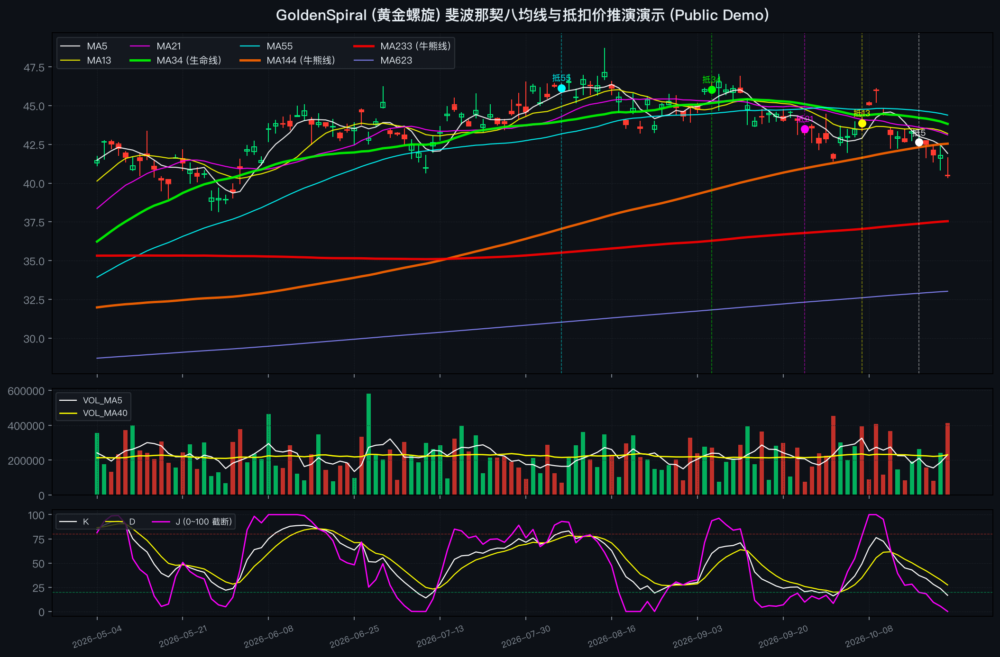

# GoldenSpiral (黄金螺旋) — 斐波那契均线簇与“向右看”抵扣价推演 Demo

> **公开演示版说明 (Public Showcase Edition)**  
> 本仓库是 **GoldenSpiral AI Agent Skill** 的公开概念演示版本，旨在介绍**斐波那契均线体系**与**“向右看”抵扣价微分推演**的基础数学逻辑与可视化效果。仅包含基础概念说明与通用可视化脚本，不包含私密实盘战法参数、微观盘口细则及内部课程资料。

---

## 一、核心理念：为什么叫“向右看”？

传统的均线分析往往是“向左看”（后视镜思维）——等金叉或死叉已经发生后再做反应，天然带有滞后性。  
**GoldenSpiral（黄金螺旋）** 的核心在于通过简单移动平均线（SMA）的一阶差分性质，利用历史**抵扣价（间隔线）**在当下直接推演未来均线的拐头方向与斜率变化，从而实现**“向右看”（前瞻性推演）**。

---

## 二、核心概念简述

### 1. 斐波那契八均线系统 (Fibonacci 8-MA Matrix)

不同于常规软件默认的 `5 / 10 / 20 / 60` 均线，本体系采用斐波那契数列（Fibonacci Sequence）构建**短、中、长三族共 8 条均线**，贴合市场自然情绪与时间对称周期：

| 均线分族 | 参数周期 | 图表颜色 | 核心角色定位 |
| :--- | :--- | :--- | :--- |
| **短线族** | **MA5 / MA13 / MA21** | 白 / 黄 / 紫 | 反映短期资金攻击斜率、强势回调承接与小波段节奏 |
| **中线族** | **MA34（加粗）/ MA55** | **绿（生命线）** / 青 | **MA34 为波段多空生命线**，决定中期持仓与防御边界 |
| **长线族** | **MA144 / MA233（加粗）/ MA623** | **橙 / 红（牛熊线）** / 蓝紫 | 刻画大级别牛熊成本中枢、长期趋势底座与空间极值 |

---

### 2. “向右看”：间隔线与抵扣价推演原理

对于任意周期为 $N$ 的均线，今日均线值与昨日均线值的变化量 $\Delta \text{MA}(N)$ 满足严格的数学恒等式：

$$\Delta \text{MA}(N) = \text{MA}_t(N) - \text{MA}_{t-1}(N) = \frac{C_t - C_{t-N}}{N}$$

其中：
- $C_t$：当前最新收盘价（现价）
- $C_{t-N}$：往前数第 $N$ 根 K 线的收盘价，即**抵扣价（间隔线位置）**

**直观推论**：
- **均线向上助涨**：当 `现价 > 抵扣价`（且未来数日抵扣价处于历史低位区）时，哪怕价格横盘，均线也会加速上翘提供支撑。
- **均线走平刹车**：当大跌后的均线即将进入低位抵扣区（`现价 ≈ 抵扣价`）时，陡峭下行的均线将自然减速走平，形成“刹车线”。
- **均线向下压制**：当 `现价 < 抵扣价`（且未来数日即将抵扣历史高位峰区）时，均线将面临下拐压力，单根大阳线强行穿越多条下行均线往往伴随回踩揉搓。

---

### 3. 极值截断 KDJ 与双轨隔离设计

- **KDJ 钝化截断 (0~100)**：将传统 KDJ(14,3,3) 的数值严格约束在 `[0, 100]` 区间内，用于观察单边趋势中的高位钝化与波段末端的极值衰竭。
- **双轨解耦原则**：在系统架构上，将**中长线趋势波段**（依托大周期均线与抵扣价演进）与**超短线情绪博弈**彻底分离，避免不同周期的交易逻辑相互干扰。

---

## 三、可视化示例 (Demo Preview)

运行 `python3 demo.py` 生成的暗色风格斐波那契八均线、抵扣价标记（`抵5`、`抵13`、`抵34` 等）及钝化 KDJ 示意图：



---

## 四、快速体验

### 1. 安装依赖
```bash
pip install -r requirements.txt
```

### 2. 运行演示脚本
```bash
# 方式 A：使用内置模拟波浪数据一键生成推演表与图表（默认无需联网）
python3 demo.py

# 方式 B：传入 6 位 A 股代码，通过开源接口拉取前复权日线进行可视化演示
python3 demo.py 600519
```

终端将输出各条均线的抵扣日期、抵扣价格及斜率推演方向：

```text
====================================================================
  GoldenSpiral (黄金螺旋) 均线与抵扣价推演系统 - 公开演示版 Demo
====================================================================
[+] “向右看”抵扣价差分推演表 (ΔMA = (现价 - 抵扣价) / N):
--------------------------------------------------------------------
    MA(  5) | 抵扣日: 2026-10-17 | 抵扣价:    42.63 | 差值:    -2.11 -> 向下压制 (现价 < 抵扣价)
    MA( 13) | 抵扣日: 2026-10-05 | 抵扣价:    43.88 | 差值:    -3.36 -> 向下压制 (现价 < 抵扣价)
    MA( 21) | 抵扣日: 2026-09-24 | 抵扣价:    43.51 | 差值:    -2.99 -> 向下压制 (现价 < 抵扣价)
    MA( 34) | 抵扣日: 2026-09-05 | 抵扣价:    46.03 | 差值:    -5.51 -> 向下压制 (现价 < 抵扣价)
    MA( 55) | 抵扣日: 2026-08-06 | 抵扣价:    46.14 | 差值:    -5.62 -> 向下压制 (现价 < 抵扣价)
    MA(144) | 抵扣日: 2026-03-29 | 抵扣价:    34.45 | 差值:    +6.07 -> 向上助涨 (现价 > 抵扣价)
    MA(233) | 抵扣日: 2025-11-20 | 抵扣价:    32.37 | 差值:    +8.15 -> 向上助涨 (现价 > 抵扣价)
    MA(623) | 抵扣日: 2024-05-04 | 抵扣价:    21.62 | 差值:   +18.90 -> 向上助涨 (现价 > 抵扣价)
--------------------------------------------------------------------
```

---

## 免责声明
本仓库仅作为量化可视化与 AI Agent Skill 结构的公开技术演示，不构成任何投资建议。
